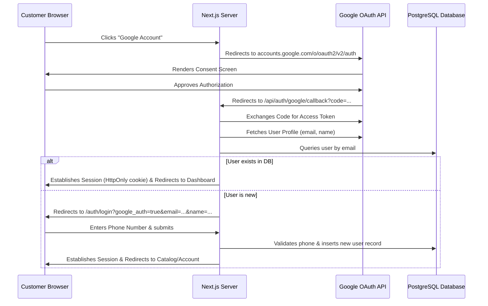

# Google OAuth Integration Guide

This guide explains the architecture, configuration steps, and local testing instructions for the Google Authentication flow in **CamRents Thrissur**.

---

## 1. Architectural Overview & Challenges

Unlike standard email-first SaaS applications, CamRents is designed around a **phone-number-first user model**. This is a business requirement because:
1. **Physical Gear Security**: Rentals require verification of physical local identities, local addresses, and active phone contacts.
2. **KYC Verification**: Physical shop pickups require verifying phone numbers and linking them to photographic ID records.
3. **SMS Alerts & Communications**: Operational updates, bookings, and late fee alerts are sent via SMS/WhatsApp.

### The Difficulty
Google OAuth only provides a user's **email, name, and profile image**—it does *not* provide a verified mobile number. 

### The Solution: Multi-Step progressive Registration
To reconcile Google's email authentication with our phone-based database constraints, we implement a **progressive registration flow**:



---

## 2. Google Cloud Console Setup

To configure Google OAuth, you need to create credentials in the Google Cloud Console:

1. **Go to the Console**: Navigate to the [Google Cloud Console](https://console.cloud.google.com/).
2. **Create a Project**: Click the project dropdown and select **New Project**. Name it `CamRents`.
3. **Configure OAuth Consent Screen**:
   - Go to **APIs & Services** > **OAuth consent screen**.
   - Select **External** user type and click **Create**.
   - Fill in the required **App information** (e.g., App name, User support email, Developer contact email).
   - Click **Save and Continue** (skip Scopes and Test Users for now).
4. **Create OAuth Client Credentials**:
   - Go to **APIs & Services** > **Credentials**.
   - Click **+ Create Credentials** and select **OAuth client ID**.
   - Select **Web application** as the Application type.
   - Set the name to `CamRents Local Development`.
   - **Authorized JavaScript origins**:
     - `http://localhost:3000`
   - **Authorized redirect URIs**:
     - `http://localhost:3000/api/auth/google/callback`
5. **Get Credentials**: Copy the generated **Client ID** and **Client Secret**.

---

## 3. Environment Variable Configuration

Add the Google OAuth secrets to your local [`.env`](file:///D:/projects%20codes/websites/camrents/.env) file:

```env
# Google OAuth Configuration
GOOGLE_CLIENT_ID=your_client_id_here.apps.googleusercontent.com
GOOGLE_CLIENT_SECRET=GOCSPX-your_client_secret_here
```

Restart the development server (`pnpm dev`) after updating the environment variables.

---

## 4. Source Code Architecture

- **Initiate Redirection**: [/src/app/api/auth/google/route.ts](file:///D:/projects%20codes/websites/camrents/src/app/api/auth/google/route.ts)
  - Redirects the browser to Google's OAuth 2.0 authorization endpoint with requested scopes: `openid email profile`.
- **Callback Endpoint**: [/src/app/api/auth/google/callback/route.ts](file:///D:/projects%20codes/websites/camrents/src/app/api/auth/google/callback/route.ts)
  - Exchanges the code parameter for tokens, queries the user profile, establishes user sessions via HttpOnly `camrents_session` cookies, and handles redirection logic.
- **Register Action**: [/src/lib/actions/auth.ts](file:///D:/projects%20codes/websites/camrents/src/lib/actions/auth.ts) > `registerWithGoogle`
  - Validates user payload (including the phone format using `googleRegisterSchema`), checks for duplicates, and writes the user record to the database.
- **UI Form View**: [/src/app/auth/login/page.tsx](file:///D:/projects%20codes/websites/camrents/src/app/auth/login/page.tsx)
  - Automatically detects environment capabilities via the server action `isGoogleConfigured()`. If environment secrets are missing, it falls back to a simulated developer dialog box for easy prototyping.
